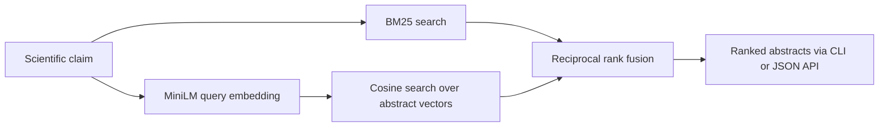

# Hybrid Scientific Evidence Search

A local search prototype that retrieves scientific evidence using BM25, MiniLM sentence embeddings, and reciprocal rank fusion. It includes a command-line interface, a JSON search API, and reproducible retrieval experiments on the [BEIR SciFact benchmark](https://huggingface.co/datasets/BeIR/scifact).

## Benchmark results

The corpus contains **5,183 scientific abstracts**. The method was selected using **809 validation queries**, then evaluated on a separate **300-query public evaluation split**.

| Method | nDCG@10 | Recall@10 | MRR@10 |
|---|---:|---:|---:|
| BM25 | 0.6634 | 0.7876 | 0.6309 |
| MiniLM dense retrieval | 0.6451 | 0.7833 | 0.6047 |
| **Hybrid RRF** | **0.6802** | **0.8139** | **0.6415** |

Hybrid retrieval was selected by validation nDCG@10 before evaluation. On this benchmark it improved nDCG@10 by 0.0168 absolute over BM25. These results do not establish statistical significance or performance on other corpora.

See [RESULTS.md](RESULTS.md), [machine-readable metrics](artifacts/metrics.json), and [per-query results](artifacts/per_query_metrics.csv).

## Architecture



- **Lexical retrieval:** word tokenization and BM25 with fixed `k1=1.2`, `b=0.75`.
- **Dense retrieval:** frozen `sentence-transformers/all-MiniLM-L6-v2` through ONNX Runtime, attention-masked mean pooling, normalized 384-dimensional embeddings, and exact cosine search.
- **Hybrid ranking:** reciprocal rank fusion of each retriever's top 100 documents, using fixed `k=60`.
- **Evaluation:** nDCG@10, Recall@10, MRR@10, per-query reports, and measured local query latency.

The encoder is pretrained and reused without fine-tuning. Source model revision and data checksum are recorded for reproducibility.

## Quick start

Use **Python 3.12**, the tested version.

```bash
git clone https://github.com/WhiteDevil377/scientific-evidence-search.git
cd scientific-evidence-search
python3 -m venv .venv
source .venv/bin/activate
python -m pip install -r requirements.txt
python prepare.py
python evaluate.py
python verify.py
```

On Windows, activate the environment with `.venv\Scripts\activate`.

`prepare.py` downloads and extracts the public dataset and downloads approximately 90 MB of pretrained ONNX model weights. The model revision is pinned in `model_revision.json`. Data, model weights, and the generated index are excluded from Git. `evaluate.py` builds a reusable local index and writes reports under `artifacts/`.

### Search from the command line

```bash
python search.py "Scientific evidence for a biological mechanism" --method hybrid_rrf --top-k 5
```

Available methods: `bm25`, `dense_minilm`, and `hybrid_rrf`.

### Run the local API

```bash
python serve.py --port 8765
```

Open these endpoints:

- Health: http://127.0.0.1:8765/health
- Search: http://127.0.0.1:8765/search?q=scientific%20evidence&method=hybrid_rrf&top_k=5

Responses include document IDs, titles, abstracts, and ranking scores. Scores are not probabilities. This is a local demonstration API that retrieves candidate evidence; it does not classify claims as true or false.

## Experiment design and verification

The pipeline checks unique document IDs, nonempty indexed documents, valid relevance references, and disjoint query IDs between validation and evaluation splits. BEIR's train judgments are used only to select among the three fixed retrieval methods. The selected method is frozen before calculating evaluation scores.

The verification script checks a hand-computed ranking-metric example, reciprocal rank fusion, embedding padding invariance, vector normalization, valid search results, and actual API success and invalid-query responses.

The local timing report covers 50 sequential validation queries. It includes query encoding, both scoring paths, and rank fusion, while excluding startup, indexing, downloads, and HTTP overhead. It is not a production throughput benchmark.

## Limitations and next experiments

- This is one small, public retrieval benchmark, not the original SciFact hidden test evaluation.
- MiniLM was pretrained on public sentence pairs, including scientific citation data; overlap with benchmark documents cannot be ruled out.
- Abstracts are truncated to 256 wordpieces. This can discard relevant evidence.
- Shared evidence documents can occur across query splits in the fixed corpus. Unjudged abstracts are treated as nonrelevant.
- Exact search over 5,183 documents does not demonstrate million-document scalability. The BM25 tokenizer and evaluation implementation are project-specific rather than a reproduction of the BEIR leaderboard configuration.

Useful extensions include cross-encoder reranking, abstract chunking, query-level bootstrap intervals, evaluation on another corpus, and approximate indexing with measured recall and latency.

## Sources and attribution

- [Sentence Transformers retrieval reference](https://www.sbert.net/examples/sentence_transformer/applications/retrieve_rerank/README.html)
- [BEIR SciFact dataset and license](https://huggingface.co/datasets/BeIR/scifact)
- [Original SciFact project](https://github.com/allenai/scifact): Wadden et al. (2020), *Fact or Fiction: Verifying Scientific Claims*
- [MiniLM model card and pooling instructions](https://huggingface.co/sentence-transformers/all-MiniLM-L6-v2)

BEIR identifies the dataset license as [CC BY-SA 4.0](https://creativecommons.org/licenses/by-sa/4.0/). Data and derived index artifacts retain that attribution and license. MiniLM model weights are identified as Apache 2.0 by their model card and are downloaded from the credited, pinned revision. Third-party libraries retain their respective licenses.

This prototype was developed with AI assistance. The pretrained encoder, public data, and established ranking algorithms are credited above; no new model training or novel retrieval algorithm is claimed.
